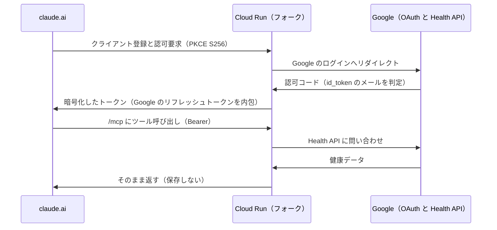

# 自分用 Google Health MCP サーバーの設計

Pixel Watch のデータを claude.ai（Web とスマホアプリ）から参照したい。そのため、shmsi/google-health-mcp（Go、MIT ライセンス）をフォークし、自分の GCP プロジェクトの Cloud Run に置く。フォークでは、レビューで見つかった穴を塞ぐ小さな修正だけを加える。健康データはサーバーのどこにも残さない。

この文書の読者は実装計画を立てる担当者で、利用者へ聞き直さずに作業を進められることを目指す。合意済みの事項、提案（設計者の判断）、未確認の事項を区別して示す。

## 背景と目的

Pixel Watch のデータは Google Health API（Fitbit Web API の後継）から読める。Claude には公式の Health Connect 連携があるが、米国限定のため使えない。そこで、Google Health API への問い合わせを中継するだけのリモート MCP サーバーを自分で置き、claude.ai のカスタムコネクタとして接続する。

利用者は本人1人である。成功の条件は、claude.ai の Web とスマホアプリの両方から、自分の健康データについて質問して答えが返ることである。

### スコープ

- 上流コミット 1874a2cf のフォークと、後述の修正
- ローカルモードでの動作確認と、データ型ごとの取得可否の調査
- GCP プロジェクトの準備、Cloud Run へのデプロイ、予算アラート
- claude.ai（Web とスマホ）への接続確認
- ツールとスコープの増減について、現状の把握と提案

### スコープ外

- 上流への PR や Issue（利用者の決定）
- Health Connect のデータを端末から送り出す方式（同期アプリと DB）
- TS などへの書き直し（必要になったら別途判断する）
- ツールとスコープの増減の実装（提案まで）

## 制約

- **健康データを残さない**: DB、キャッシュ、ログのいずれにも健康データを残さない。そのため、取得結果を保存して返す方式は選べない。
- **claude.ai は OAuth を要求する**: カスタムコネクタは OAuth 必須である。サーバー側に OAuth の認可サーバーが要る。上流の hosted モード（`internal/remote/`）がこれを持つ。
- **Google OAuth の公開ステータス**: 「テスト」では7日でリフレッシュトークンが失効する。利用者は、使えるなら「本番環境」にし、使えなければ「テスト」のまま週1回再接続すると決めた。100ユーザー未満の個人利用は審査なしで使え、ログイン時に「未確認のアプリ」の警告が出る、というのが利用者の理解である（未確認事項 1）。
- **Cloud Run には請求先アカウントが要る**: 無料枠に収まる想定だが、予算アラートを設定する。
- **タイムゾーン**: Asia/Tokyo とする。
- **手元の Go**: Go 1.27.4 を mise で入れた。設定ファイルには未登録である。

## 方式の比較

基準は、健康データを他人に読まれないことと、claude.ai から早く使えることの2つである。この2つから、OAuth の実装をどこから持ってくるかが主な比較点になる。

| 案 | 内容 | 判定 |
|---|---|---|
| A | Go のフォークを最小限直して使う | 採用（C の前半） |
| B | TS で書き直す | 今回は採らない |
| C | A で動かし、必要なら後で B | 採用 |

B は利用者の得意な言語で保守しやすい。ただし、最も誤りやすく、誤ると健康データが他人に読まれる OAuth サーバーを自作することになる。上流の OAuth はテスト付きで、レビューでも実害のある欠陥は見つからなかった。そのため今回は A で動かし、ツールやスコープを大きく変える段階で Go が負担なら B を検討する（C）。応答時間は Google への通信が大半を占めるため、言語の速度差は判断に使わない。

フォークは GitHub の公開フォークに置く（利用者の決定）。秘密の値はデプロイ時の環境変数と Secret Manager で渡し、リポジトリには入れない。上流は作成翌日でコミットが1つだけなので、上流の更新を取り込む前提にはしない。取り込む場合は差分を読んでから行う。

## 構成とデータの流れ

サーバーは永続ストアを持たない。クライアント登録、認可コード、アクセストークン、リフレッシュトークンは、どれも署名鍵（`MCP_SIGNING_KEY`）で AES-256-GCM により暗号化した値として、相手に持たせる。Google のリフレッシュトークンも、暗号化された形で claude.ai 側が持つ。そのため、インスタンスの再起動やスケールゼロでもログイン状態は消えない。

メモリに残るのは、Google のアクセストークンのキャッシュとツールの入力スキーマだけである。健康データは、リクエストの処理が終わると参照が消える。

### 失敗時の動作

- **許可外のアカウントでのログイン**: Google からのコールバックで拒否する。
- **許可リストから外したアカウント**: 既に発行したトークンも `/mcp` で毎回弾く。
- **Google のリフレッシュトークンの失効**: `/mcp` が 401 を返し、claude.ai で再接続が要る。
- **署名鍵の入れ替え**: 全トークンが無効になる。

## フォークで加える変更

レビューで見つかった点のうち、コードを変えないと塞げないものだけを直す。

### 1. 戻り先ホストの制限をデプロイスクリプトに入れる

`deploy/cloudrun.sh:103` は `--set-env-vars` で環境変数を全置換し、`ALLOWED_REDIRECT_HOSTS` を含めない。このままでは、誰でもクライアントを登録して任意の https ホストを戻り先にできる。攻撃者が「Claude」を名乗るリンクを送り、利用者が同意画面で進むと、読み取りトークンが攻撃者に渡る。ログインするのは本人なので、`ALLOWED_EMAILS` では防げない。

スクリプトに環境変数 `ALLOWED_REDIRECT_HOSTS`（既定値 `claude.ai,claude.com`）を足し、`--set-env-vars` に含める。手で `gcloud` から足すだけでは、次にスクリプトでデプロイしたときに消える。`claude.com` は、claude.ai の戻り先が将来 claude.com に移る可能性への備えである。

### 2. max instances を指定できるようにする

`cloudrun.sh:101` は `--max-instances 2` で固定している。環境変数 `MAX_INSTANCES`（既定値 1）で指定できるようにする。課金の上限を抑え、無認証で叩ける `/oauth/register` への大量アクセスの影響も1台分に抑えるためである。

### 3. Google のエラーをログに出す箇所を絞る

`internal/remote/remote.go:484,586,626` は `x/oauth2` のエラーを `%v` でそのままログに出す。`x/oauth2` v0.38.0 の `RetrieveError` は、応答に `error` コードがないとき本文全体（最大 1MB）を文字列に含める。Google が HTML のエラーページなどを返すと、その本文が Cloud Logging に残る。

`errors.As` で `*oauth2.RetrieveError` を取り出し、HTTP ステータスと `ErrorCode` だけを出すようにする。それ以外のエラー型は、型名か固定文言だけを出す。

### 4. ベースイメージをダイジェストで固定する

Dockerfile の `golang:1.27` と `gcr.io/distroless/static-debian12:nonroot` はタグ指定だけである。`@sha256:...` で固定する。`.github/dependabot.yml` には docker の月次更新が既にあり、固定後の更新はそれに任せる。

### 5. 手元の Go のバージョンを記録する

リポジトリ直下に `mise.toml` を置き、`go = "1.27.4"` を書く。

### 変えないもの

上流の設計判断で、1人利用では実害に届かないものはそのまま受け入れる（「引き受けるリスク」の節）。

## 設定値

`deploy/cloudrun.sh` に渡す値を示す。

| 変数 | 値 | 区分 |
|---|---|---|
| `PROJECT_ID` | この用途専用の新しいプロジェクト | 提案 |
| `REGION` | `asia-northeast1`（東京） | 提案 |
| `ALLOWED_EMAILS` | 利用者の Google アカウント1つ | 合意済み |
| `ALLOWED_REDIRECT_HOSTS` | `claude.ai,claude.com` | 提案 |
| `MAX_INSTANCES` | 1 | 合意済み |
| `GOOGLE_HEALTH_TZ` | `Asia/Tokyo` | 合意済み |
| `GOOGLE_HEALTH_EXTRA_SCOPES` | 空（既定の5スコープのみ） | 合意済み |
| `GOOGLE_OAUTH_CLIENT_ID` など | Web application の OAuth クライアント | 合意済み |

専用プロジェクトにする理由は、スクリプトがプロジェクト単位で権限を付けるためである。`cloudrun.sh` は既定の Compute サービスアカウントに `roles/run.builder` を付ける。他の用途と同居させると、その権限が他にも及ぶ。

`GOOGLE_HEALTH_API_BASE` は設定しない。この変数を変えると、トークンと健康データがその宛先へ送られる。デプロイ後に `gcloud run services describe` で未設定であることを確かめる。

GitHub Actions からの自動デプロイ（`deploy/setup-github-ci.sh`）は使わず、手元から `cloudrun.sh` でデプロイする（提案）。Workload Identity などの設定が増えるわりに、1人で手元から操作する運用では得るものが少ない。

予算アラートの金額は、月1,000円に対して50%、90%、100%で通知する案とする（提案）。

## 作業の順序と確かめ方

利用者が挙げた5ステップのうち、ステップ1（コードレビュー）は済んでいる。結果は「フォークで加える変更」と「引き受けるリスク」に反映した。

ローカルでの動作確認（ステップ2）にも、Google Health API を有効にしたプロジェクトと OAuth クライアントが要る。そのため、GCP の準備（ステップ3）のうち、プロジェクト作成、API の有効化、同意画面、Desktop app の OAuth クライアント作成をステップ2の前に行う（提案）。公開ステータスはステップ2の間は「テスト」でよく、ステップ4の前に「本番環境」にする。

### ローカルでの確認

ローカルモード（`login` のあと `serve`、stdio）で Claude Code から接続する。Pixel Watch 以外のアプリが Health Connect に書いたデータが、Google Health API から返るかを確かめる。`get_data_points` は既定で `dataSource` を消すので、`verbose=true` を付けて記録元を見る。

結果は、データ型ごとに「返る」「返らない」と記録元（`dataSource` の platform と device）を表にする。表はフォークの `docs/` に置く。公開リポジトリなので、測定値、日時、端末の個体を特定できる情報は載せず、データ型と記録元の種類だけを載せる（提案）。

### デプロイ後の確認

- `/health` が `ok` を返す
- `GOOGLE_HEALTH_API_BASE` が未設定で、`ALLOWED_REDIRECT_HOSTS` と max instances が設定どおり
- claude.ai の Web でカスタムコネクタを追加し、ログインしてツールが答えを返す
- スマホアプリでも同じコネクタでツールが答えを返す
- 許可外の Google アカウントでのログインが拒否される

### 後で調整したいことの提案

ツールとスコープの増減は、ローカルでの確認の表をもとに提案だけを書く。既定の5スコープは `internal/auth/auth.go:36-42` で固定されており、減らすにはコードの修正が要る。利用者は、使わないデータについてはツールだけでなくスコープからも外したいと考えている。

## 引き受けるリスク

次の点は上流の設計判断であり、1人利用では実害に届かないため、直さずに受け入れる。

| 点 | 受け入れる理由 |
|---|---|
| トークンを個別に取り消せない | Google 側の取り消しと鍵の入れ替えで復旧できる |
| 認可コードを何度でも使える | 有効期限が5分で、PKCE とクライアントに結び付く |
| id_token の署名を検証しない | Google から TLS で直接受け取り、仕様上許される |
| PKCE の比較が定数時間でない | 比較する値は URL に載る公開値である |
| リクエストログに OAuth の値が残る | 暗号化済みで、メールやトークンを含まない |
| メモリの Google トークンが残る | 1人利用ではエントリが増えない |
| x/sys の脆弱性 GO-2026-5024 | Windows 限定で、コードから呼ばれない |

トークンが漏れたと疑うときは、Google アカウントの「サードパーティのアクセス」で取り消し、Secret Manager の署名鍵を入れ替えてデプロイし直す。鍵を入れ替えると、claude.ai での再接続が要る。

健康データとして既定の5スコープ（活動、心拍などの測定値、睡眠、プロフィール、設定）を読ませることは、漏れても許容できると利用者が判断した。漏らさない対策は、外部への通信先の確認（Google のみ）と、戻り先とアカウントの制限で取る。

## 未確認事項

1. **本番環境・未審査で使えるか**: 上流の README（`README.md:388-392`）は、Google Health のスコープを restricted とする。公開には Google の審査が要るとも書く。審査なしの個人利用が restricted スコープでも許されるかは未確認である。GCP の準備のあと、デプロイの前に本番環境へ切り替えてログインを試す。使えなければ「テスト」に戻し、週1回 claude.ai で再接続して運用する（利用者の決定）。審査を受ける案と方式の見直しは採らない。
2. **本番環境でリフレッシュトークンが失効しないか**: 運用しながら確かめる。
3. **claude.ai の戻り先 URL**: `https://claude.ai/api/mcp/auth_callback` とされるが、Anthropic のサポート記事の原文は未確認である。`ALLOWED_REDIRECT_HOSTS` の値に関わるので、接続時に確かめる。
4. **Health Connect 経由のデータの取得範囲**: ローカルでの確認で調べる。
5. **既定スコープで運動の GPS ルートが取れるか**: README では位置情報は追加スコープ扱いだが、実データでは未確認である。

## 担当者に任せること

- 修正 3 のログの文言と、`RetrieveError` 以外のエラーの扱い
- 各修正にテストを足すかどうか。足す場合は自前の純粋なロジックに限り、外部ライブラリの差し替えを伴うテストは足さない
- GCP の各設定を `gcloud` で行うか、コンソールで利用者に操作してもらうか
- コミットの分け方
